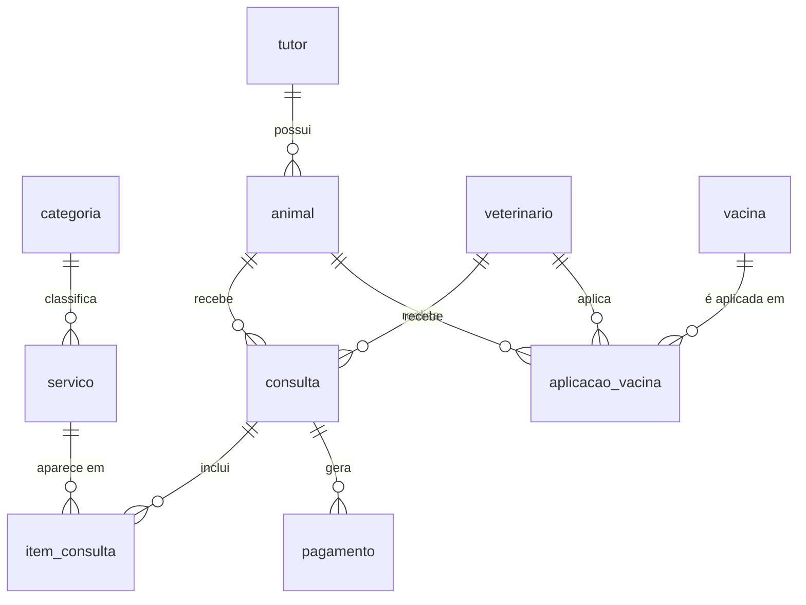
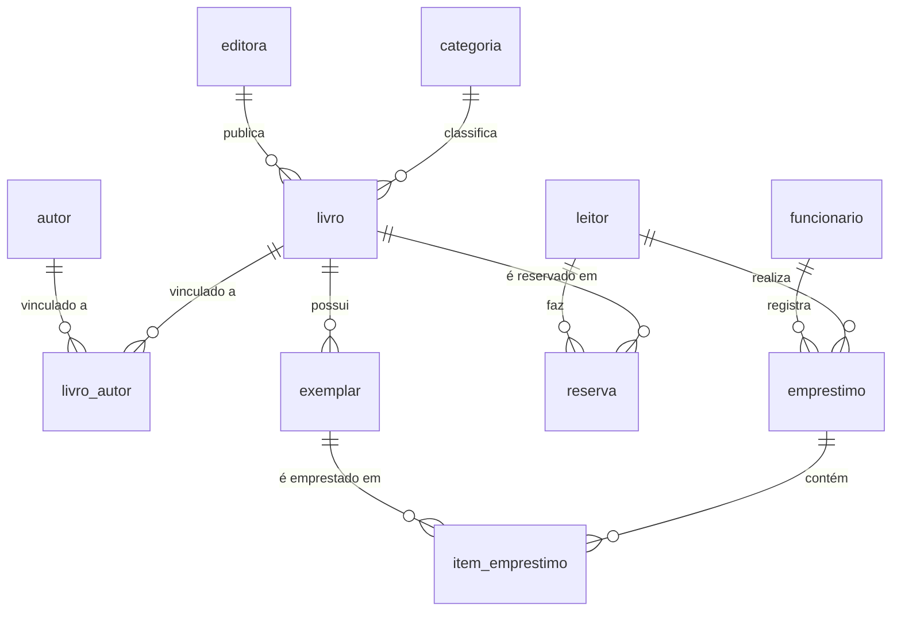

# Desafios SQL


Repositório com dois desafios práticos de banco de dados desenvolvidos durante os estudos de Desenvolvimento de Sistemas. Cada desafio traz a modelagem, a criação das tabelas com suas restrições, dados de exemplo e 30 consultas SQL.

## Estrutura do repositório

```
.
├── README.md
├── clinica_veterinaria.sql
└── desafio_biblioteca.sql
```

## Projetos

### 🐾 Clínica Veterinária

Banco de dados para gerenciar uma clínica veterinária: tutores e seus animais, veterinários, serviços, consultas, pagamentos e vacinação.

📁 [clinica_veterinaria.sql](./clinica_veterinaria.sql)

#### Modelo de dados



#### Tabelas

| Tabela | Descrição |
|---|---|
| `categoria` | Categorias dos serviços |
| `tutor` | Donos dos animais |
| `animal` | Animais, cada um vinculado a um tutor |
| `veterinario` | Profissionais que realizam consultas e aplicam vacinas |
| `servico` | Serviços oferecidos e seus preços |
| `consulta` | Atendimentos de um animal com um veterinário |
| `item_consulta` | Serviços realizados em cada consulta |
| `pagamento` | Pagamentos das consultas |
| `vacina` | Vacinas cadastradas |
| `aplicacao_vacina` | Vacinas aplicadas em cada animal |

#### Regras de integridade

- **Tutor:** e-mail único, com formato básico de e-mail.
- **Veterinário:** CRMV e e-mail únicos.
- **Serviço:** nome único e preço não negativo.
- **Consulta:** status `AGENDADA`, `REALIZADA`, `CANCELADA` ou `FALTOU`. Um veterinário não pode ter duas consultas no mesmo horário.
- **Itens da consulta:** quantidade maior que zero, preço não negativo, e o mesmo serviço não pode aparecer duas vezes na mesma consulta.
- **Pagamento:** valor maior que zero, com status `PENDENTE`, `APROVADO` ou `RECUSADO`.
- **Vacina:** nome único. O mesmo animal não pode receber a mesma vacina duas vezes no mesmo dia.
- **Exclusões:** apagar uma consulta apaga seus itens em cascata. Nos demais casos, a exclusão é bloqueada enquanto houver registros dependentes.
- **Atualizações:** todas as chaves estrangeiras propagam mudanças (`ON UPDATE CASCADE`).

#### Consultas

O script traz 30 consultas (Questões 01 a 30). Algumas usam `LEFT JOIN` para encontrar registros sem correspondência, como tutores sem animais. Outras combinam agregações com `GROUP BY` e `HAVING`, e algumas usam subconsultas.

<details>
<summary>Ver as 30 consultas</summary>

1. Animais e tutores
2. Animais por tutor
3. Consultas e animais
4. Consultas e veterinários
5. Detalhamento dos atendimentos
6. Quantidade de consultas por tutor
7. Tutores sem animais
8. Quantidade de animais por espécie
9. Espécie com mais animais
10. Veterinários e consultas
11. Veterinários sem consultas
12. Serviço mais caro
13. Serviços nunca utilizados
14. Serviços por consulta
15. Serviços mais realizados
16. Consultas e pagamentos
17. Consultas sem pagamento
18. Histórico de vacinação
19. Animais sem vacinação registrada
20. Média de preço por categoria
21. Quantidade de aplicações por vacina
22. Quantidade de consultas por status
23. Valor total por consulta
24. Valor total dos atendimentos por tutor
25. Resumo dos animais
26. Tutores com muitas consultas
27. Categorias com vários serviços
28. Animais com vacinação recorrente
29. Consultas com valor alto
30. Relatório geral da clínica

</details>

### 📚 Biblioteca

Banco de dados para gerenciar uma biblioteca: livros, autores, editoras, exemplares físicos, leitores, funcionários, empréstimos e reservas. Inclui um gatilho que impede o mesmo exemplar de estar em dois empréstimos em aberto ao mesmo tempo.

📁 [desafio_biblioteca.sql](./desafio_biblioteca.sql)

#### Modelo de dados



#### Tabelas

| Tabela | Descrição |
|---|---|
| `categoria` | Categorias dos livros |
| `editora` | Editoras dos livros |
| `autor` | Autores dos livros |
| `livro` | Títulos, com ISBN, ano de publicação, categoria e editora |
| `livro_autor` | Vínculo entre livros e autores |
| `exemplar` | Cópias físicas de cada livro, com código de patrimônio |
| `leitor` | Pessoas que pegam livros emprestados |
| `funcionario` | Funcionários que registram os empréstimos |
| `emprestimo` | Empréstimos, com status `ATIVO`, `ATRASADO` ou `DEVOLVIDO` |
| `item_emprestimo` | Exemplares incluídos em cada empréstimo |
| `reserva` | Reservas de livros feitas pelos leitores, com status `PENDENTE`, `ATENDIDA` ou `CANCELADA` |

#### Regras de integridade

- **Categoria e editora:** nome único. A editora também exige e-mail em formato básico.
- **Livro:** ISBN único, com 13 dígitos, e ano de publicação entre 1400 e 2100.
- **Exemplar:** código de patrimônio único e status `DISPONIVEL`, `EMPRESTADO`, `RESERVADO` ou `INATIVO`.
- **Leitor:** e-mail único, com formato básico de e-mail.
- **Funcionário:** e-mail e matrícula únicos.
- **Empréstimo:** a data prevista de devolução e a data de devolução não podem ser anteriores à data do empréstimo. Um empréstimo com status `DEVOLVIDO` precisa ter data de devolução, e os demais não podem tê-la.
- **Itens do empréstimo:** o mesmo exemplar não pode aparecer duas vezes no mesmo empréstimo.
- **Gatilho `trg_item_emprestimo_exemplar_livre`:** antes de inserir um item, verifica se o exemplar já está em outro empréstimo `ATIVO` ou `ATRASADO`. Se estiver, a inserção é cancelada.
- **Exclusões:** apagar um livro ou um autor também remove seus vínculos em `livro_autor`, e apagar um empréstimo remove seus itens. Nos demais casos, a exclusão é bloqueada enquanto houver registros dependentes.
- **Atualizações:** todas as chaves estrangeiras propagam mudanças (`ON UPDATE CASCADE`).

#### Consultas

O script traz 30 consultas (Questões 01 a 30). Algumas usam `LEFT JOIN` para encontrar registros sem correspondência, como leitores sem empréstimos e livros nunca emprestados. Outras usam agregações, `GROUP BY`, `HAVING` e subconsultas.

<details>
<summary>Ver as 30 consultas</summary>

1. Livros e categorias
2. Livros e editoras
3. Livros e autores
4. Acervo completo
5. Exemplares por livro
6. Quantidade de empréstimos por leitor
7. Leitores sem empréstimos
8. Quantidade de livros por categoria
9. Categoria com mais livros
10. Editoras e títulos publicados
11. Editoras sem livros
12. Livro mais antigo
13. Livros nunca emprestados
14. Itens por empréstimo
15. Livros mais emprestados
16. Empréstimos e funcionários
17. Empréstimos sem devolução
18. Histórico de empréstimos
19. Livros sem exemplar disponível
20. Média de empréstimos por categoria
21. Quantidade de reservas por livro
22. Empréstimos por status
23. Leitores com devoluções atrasadas
24. Quantidade de empréstimos por funcionário
25. Resumo por leitor
26. Leitores com muitos empréstimos
27. Categorias com vários títulos
28. Livros com alta procura
29. Leitores com empréstimos ativos
30. Relatório geral do acervo

</details>

## Como executar

**Requisitos:** MySQL 8.0.16 ou superior, que é a versão a partir da qual as restrições `CHECK` são aplicadas, e o MySQL Workbench ou o cliente `mysql` de linha de comando.

Pelo MySQL Workbench:

1. Abra o arquivo `.sql` do desafio.
2. Execute o script completo com `Ctrl+Shift+Enter`.

Pelo terminal, a partir da pasta onde está o arquivo:

```bash
mysql -u root -p -e "source clinica_veterinaria.sql"
```

Para executar o outro desafio, troque o nome do arquivo por `desafio_biblioteca.sql`.

> **Atenção:** os scripts começam com `DROP DATABASE IF EXISTS` e recriam os bancos `clinica_veterinaria` e `desafio_biblioteca`. Se já existirem bancos com esses nomes, eles serão apagados junto com seus dados.

> **Observação:** o gatilho da biblioteca usa `DELIMITER`, que só é interpretado pelo cliente `mysql` (terminal ou Workbench). Por isso, não cole o script da biblioteca em editores online que não aceitam essa sintaxe.

## Tecnologias e conceitos

- **MySQL 8**
- **DDL e DML:** `CREATE`, `DROP`, `INSERT` e `SELECT`
- **Chaves:** primárias e estrangeiras, com `ON UPDATE CASCADE`, `ON DELETE RESTRICT` e `ON DELETE CASCADE`
- **Restrições:** `NOT NULL`, `UNIQUE`, `CHECK`, `DEFAULT` e `ENUM`
- **Consultas:** `JOIN`, `LEFT JOIN`, `GROUP BY`, `HAVING`, `ORDER BY` e subconsultas
- **Agregações:** `COUNT`, `SUM`, `AVG`, `MAX` e `MIN`
- **Triggers:** gatilho `BEFORE INSERT` com `SIGNAL`

## Autor

**Felipe da Silva Mousinho**  
Estudante de Desenvolvimento de Sistemas

- GitHub: [LipinnDEV](https://github.com/LipinnDEV)

---

Projeto desenvolvido para fins acadêmicos e prática de SQL.
